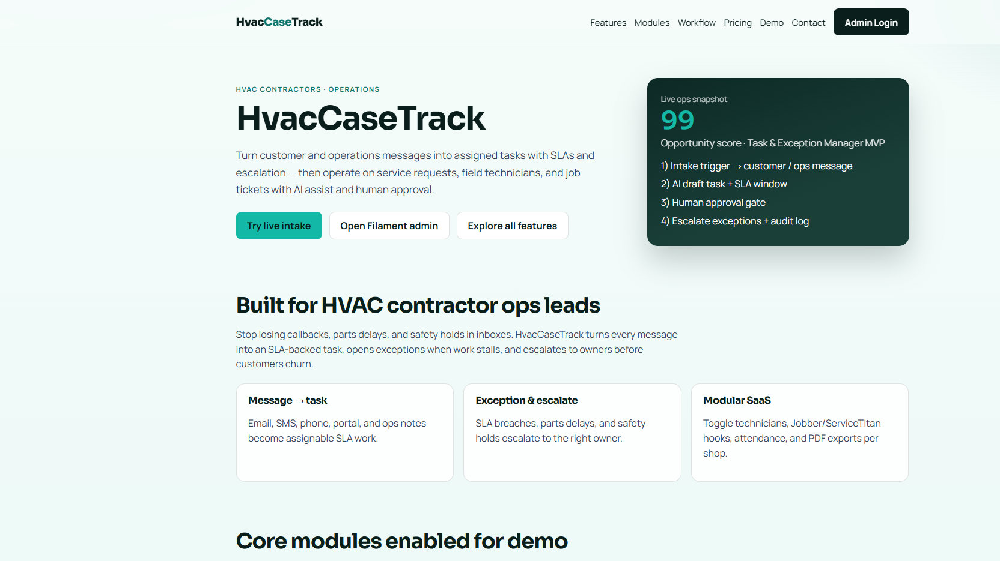
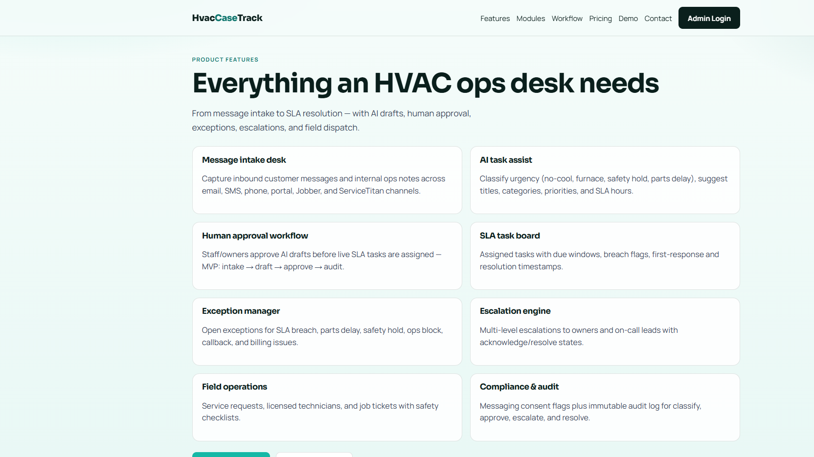
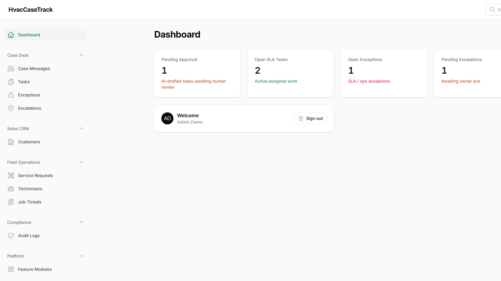
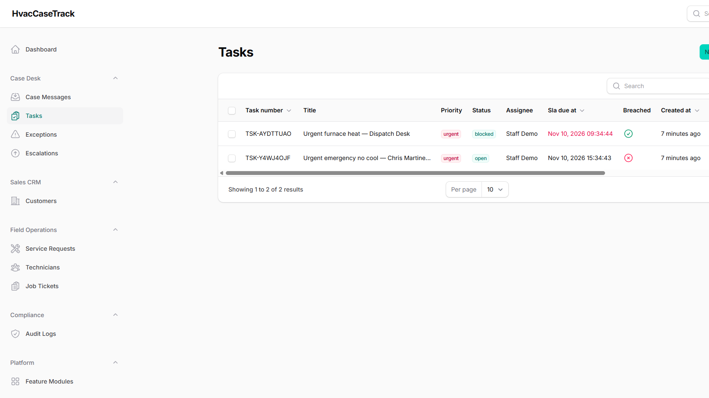

# RoofingCaseTrack — AI Task & Exception Manager for Roofing Contractors (Laravel Filament SaaS)

**RoofingCaseTrack** is the operations desk for roofing contractors who need to turn customer and operations messages into **assigned SLA tasks with escalation**. Built with **Laravel + Filament**, modular feature toggles, multi-role users, AI task assist, Docker Compose, and a public marketing site that documents every module.

> SEO focus: roofing contractors · task & exception manager · SLA automation · field service operations · storm leak response · ServiceTitan · Jobber · QuickBooks · Google Calendar · Laravel Filament SaaS · AI business automation 2026

## Why roofing contractors buy RoofingCaseTrack

For roofing contractor owners and operations leads: stop losing storm callbacks, flashing delays, and safety holds in inboxes. RoofingCaseTrack classifies inbound and internal messages, drafts SLA tasks, requires human approval, opens exceptions when work stalls, and escalates to the right owner — while operating on service requests, field technicians, and job tickets.

- **Opportunity score:** 97
- **Pilot pricing:** $299–$1,499/mo
- **MVP loop:** intake trigger → AI draft/action → human approval → audit log
- **Risk / compliance:** MED — messaging consent, licensing and safety

## Screenshots

| Home | Features |
|------|----------|
|  |  |

| Admin dashboard | Tasks |
|-----------------|-------|
|  |  |

## Public pages

| Path | Purpose |
|------|---------|
| `/` | Brand hero + core modules |
| `/features` | Full product feature list |
| `/modules` | Every module ON/OFF |
| `/workflow` | MVP intake → approve → escalate |
| `/pricing` | Pilot pricing bands |
| `/demo` | Live message intake + AI classify |
| `/contact` | Hire / contact |
| `/admin` | Filament admin panel |

## Demo users

Password for all accounts: **`password`**

| Role | Email |
|------|-------|
| Admin | admin@roofingcasetrack.test |
| Owner | owner@roofingcasetrack.test |
| Staff | staff@roofingcasetrack.test |
| Technician | tech@roofingcasetrack.test |
| Customer | customer@roofingcasetrack.test (no Filament access) |

## Feature modules (toggleable)

Core workflow modules default **ON**. Niche / integration modules default **OFF**.

### Core / AI / Compliance (ON)
- Message Intake
- AI Task Assist
- Human Approval Workflow
- SLA Tasks
- Exception Manager
- Escalation Engine
- Service Requests
- Field Technicians
- Job Tickets
- Audit Log
- Messaging Consent
- UniversalSlug Engine
- AI Hub Provider Switch
- Drutogoti Speed Layer
- Admin Panel Extras

### Optional (OFF by default)
- Customer Portal
- Attendance Hub
- Unicode PDF Exports
- AI Catalog / Parts Enrichment
- Jobber Integration
- ServiceTitan Integration
- QuickBooks Integration
- Google Calendar Integration
- Multi-Location

Toggle live in Filament → **Module Settings**.

## Core automation workflow

1. **Intake** — customer email/SMS/phone/portal or internal ops note
2. **AI assist** — category, priority, score, suggested SLA hours, task draft
3. **Human approval** — staff/owner approves → live SLA task (+ optional service request)
4. **Exception & escalate** — SLA breach / parts / safety → exception + escalation
5. **Audit log** — immutable trail of classify, approve, escalate, resolve

## Docker run (local)

Ports: **app 8137**, MySQL **33137**, Redis **63837**.

```bash
cd pipeline/apps/RoofingCaseTrack
docker rm -f roofing-case-track-app roofing-case-track-mysql roofing-case-track-redis 2>/dev/null
docker compose up -d --build
```

Then open:

- Marketing: http://localhost:8137
- Admin: http://localhost:8137/admin

Inside the container, entrypoint runs `migrate --force` and `db:seed --force` automatically. To re-seed manually:

```bash
docker compose exec app php artisan migrate --force
docker compose exec app php artisan db:seed --force
```

### Important Docker notes

- PHP image installs **ext-intl** (required by Filament) before Composer install
- `.env` uses **MySQL** (not SQLite) so tables like `module_settings` exist
- If container names conflict: `docker rm -f` then `compose up` again

## Tech stack

- PHP 8.4 · Laravel 13 · Filament 4
- MySQL 8.4 · Redis 7
- Docker Compose
- Local equivalents of imrandevbd packages (Packagist packages may be private/unavailable):
  - `drutogoti` → `App\Services\DrutogotiSpeed`
  - `laravel-admin-panel` → Filament widgets / CaseStatsOverview
  - `laravel-ai-hub` → `AiTaskAssistService`
  - `laravel-ai-catalog` → module stub (off by default)
  - `laravel-attendance-hub` → module stub (off by default)
  - `laravel-unicode-pdf` → `UnicodePdfService`
  - `laravel-universal-slug` → `SlugService`

## SEO / related keywords

Roofing contractors, roofing task management, exception management, SLA tracking, escalation workflow, field service operations, service requests, job tickets, technician dispatch, emergency roof leak, storm damage ops, hail claim follow-up, flashing parts delay, fall hazard safety hold, Jobber integration, ServiceTitan integration, QuickBooks roofing, Google Calendar dispatch, TCPA messaging consent, Laravel Filament admin, modular SaaS, AI business automation, home & field services, operations automation 2026, multi-user roles, audit log compliance, roofing CRM adjacent ops desk, contractor software, tarp emergency, re-roof scheduling, insurance claim exception.

## Contact / Hire

- Developer: Imran Ahmed (IMRAN Dev BD)
- Website: https://imrandev.bd/contact
- Email: me@imrandev.bd
- GitHub: https://github.com/imranbru99
